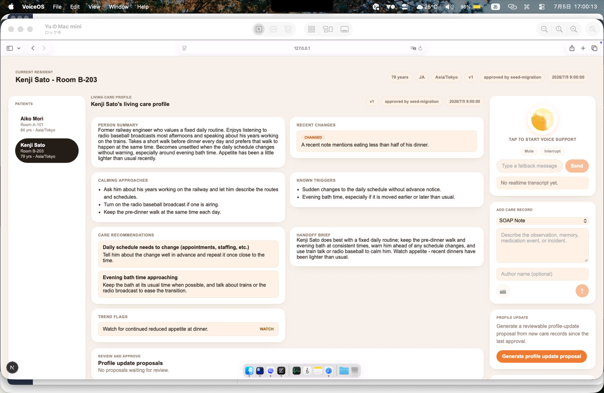
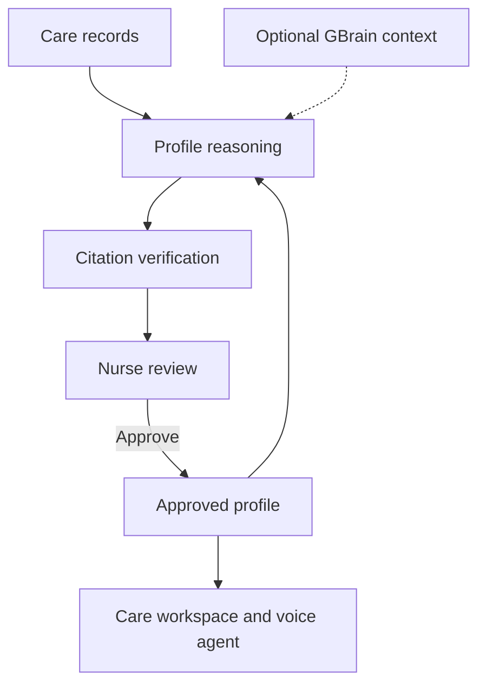

# MemoryPath

**Human-in-the-loop AI for safer, more personal dementia-care handoffs.**

MemoryPath turns fragmented care records into a continuously updated **Living Care Profile**. It gives the next nurse a clear view of who the resident is, what has recently changed, known triggers, calming approaches, and care recommendations. Every proposed update includes supporting evidence and must be reviewed by a nurse before it becomes part of the approved profile.

[](https://github.com/Jsmitty78/MemoryPath/actions/workflows/ci.yml)

[Engineering guide](docs/ENGINEERING.md) · [Architecture](ARCHITECTURE.md) · [Run locally](#run-locally) · [Tests](#validate-the-project)

**Prototype · 58 automated tests · Citation checks · Human review · Versioned profiles**



## Project at a glance

| | |
|---|---|
| **Problem** | Important care knowledge is scattered across clinical notes, incident reports, family memories, and individual staff experience. |
| **Solution** | An AI-assisted living profile that organizes changes, cites the original records, and requires nurse approval. |
| **My contribution** | Original concept, nurse interview, product leadership, workflow design, frontend/backend implementation, testing, and final presentation. |
| **Technical proof** | Structured model output, server-side citation verification, stale-update protection, resident isolation, and 58 automated tests. |
| **Stack** | Next.js 15, React 19, TypeScript, OpenAI Agents SDK, Zod, Vitest, OpenAI Realtime API. |
| **Status** | Functional hackathon prototype using synthetic resident data. Not a production medical system. |

## Project Context and Ownership

MemoryPath was developed collaboratively with Yu Yoshimuta during a hackathon. The current repository also includes subsequent development; it is not presented as the exact event submission. I originated the concept after interviewing a nurse, led the product direction, designed the core workflow, contributed to the frontend and backend, tested the record-to-profile approval flow, and delivered the final presentation.

This repository preserves the collaborative development history while documenting the product decisions and engineering work I personally led or contributed to.

## Why I Built It

Care knowledge is often spread across SOAP notes, medication records, incident reports, family memories, and individual staff experience. When shifts change, a caregiver may need to review a long record or begin without the personal context that helps them support a resident effectively.

I developed the original concept after speaking with a nurse about the difficulty of transferring this knowledge between caregivers. The goal was not to replace clinical judgment. It was to prepare useful, traceable context so the person responsible for care could review it and make the final decision.

## My Role

- Served as project manager and set the product direction
- Conducted the nurse interview used to validate the problem
- Designed the core workflow and product experience
- Contributed to frontend design and backend implementation
- Tested the complete record-to-profile approval flow
- Prepared and delivered the project presentation

## How It Works

1. A caregiver adds a care record, such as a SOAP note, nurse observation, family memory, medication record, or incident report.
2. The system stores the record as permanent source evidence.
3. An AI reasoning layer compares new information with the resident's current approved profile.
4. MemoryPath produces a field-by-field update proposal with direct citations from the source records.
5. Server-side verification removes unsupported or non-verbatim citations.
6. A nurse approves, edits, or rejects the proposal.
7. Only an approved proposal creates a new version of the Living Care Profile.

The AI can prepare an update, but it cannot modify the approved profile by itself.

## Core Features

- **Living Care Profile:** A current view of personal context, recent changes, calming approaches, triggers, recommendations, handoff information, and trend flags
- **Five record types:** SOAP notes, nurse observations, family memories, medication records, and incident reports
- **Evidence-backed proposals:** Proposed changes include direct quotations from their source records
- **Human approval gate:** Nurses can approve, reject, or edit every update
- **Versioned profiles:** Each approved change creates a traceable new version
- **Resident isolation:** Records and profiles remain separated by resident
- **Realtime voice interface:** Caregivers can ask questions grounded in the approved profile
- **Optional memory retrieval:** GBrain can supplement the reasoning context without becoming required for the application

## Safety by Design

MemoryPath is designed as a care-support prototype, not an autonomous medical system.

- Clinical-language checks warn on diagnostic or prescribing language; they do not guarantee safe model output
- A profile never changes without explicit human approval
- Generated proposal citations are checked against normalized text in the original records; this does not establish clinical correctness
- A base-version check rejects stale proposals; concurrent approvals still need transactional storage
- Resident data included in this repository is synthetic
- Safety behavior is covered by automated contract tests

## Architecture



For the complete technical design, see [ARCHITECTURE.md](ARCHITECTURE.md).

## Technology

| Area | Technology |
|---|---|
| Application | Next.js 15, React 19, TypeScript |
| AI | OpenAI Agents SDK, structured model output |
| Voice | OpenAI Realtime API over WebRTC |
| Validation | Zod |
| Testing | Vitest, 58 automated tests |
| Prototype storage | Local JSON records and versioned profile files |
| Optional retrieval | GBrain CLI |

## Important Implementation

| Path | Purpose |
|---|---|
| `src/lib/profile-agent.ts` | Extracts patterns, detects changes, and prepares structured profile proposals |
| `src/lib/proposal.ts` | Coordinates records, profiles, optional retrieval, and proposal generation |
| `src/lib/verify.ts` | Checks that every supporting quotation exists in the original records |
| `src/lib/approve.ts` | Applies approved changes and protects against stale proposals |
| `src/lib/schema.ts` | Defines records, profiles, citations, and proposals |
| `src/app/api/proposals/[id]/approve/route.ts` | Enforces the human approval gate |
| `src/components/NextNurseView.tsx` | Presents the approved profile and its supporting evidence |
| `tests/safety-contract.test.ts` | Tests the main safety guarantees |

## Run Locally

### Requirements

- Node.js 20 or later
- An OpenAI API key

### Setup

```bash
git clone https://github.com/Jsmitty78/MemoryPath.git
cd MemoryPath
npm ci
cp .env.example .env.local
```

Add your API key to `.env.local`:

```env
OPENAI_API_KEY=your_key_here
```

Start the application:

```bash
npm run dev
```

Open [http://localhost:3000](http://localhost:3000).

## Validate the Project

These checks use simulated model responses and need no live API key:

```bash
npm test
npm run typecheck
npm run lint
npm run build
```

All 58 tests, type checking, lint, and the production build passed locally on 13 November 2026. [Exact scope, test map, and known limits](docs/ENGINEERING.md). The linked CI workflow tracks subsequent runs.

The test suite covers record storage, proposal generation, citation verification, approval behavior, profile versioning, resident isolation, and the GBrain fallback.

## Prototype Scope

This repository demonstrates the complete interaction from record ingestion to an approved profile update. It is not a production healthcare product.

Current limitations include:

- Synthetic data for two demonstration residents
- Local JSON storage instead of a production database
- No authentication or role-based access control; the approval action does not verify that the caller is a nurse
- Local-file approval is not transactional, and edited approval citations are not re-verified against records
- No live deployment or demo video yet
- Proposal quality and latency depend on the connected model
- The camera control is a disabled interface placeholder

Before real-world use, the system would require secure identity management, encrypted production storage, audit controls, healthcare and privacy review, facility integration, and structured user testing.

## Product Direction

The next stage would focus on secure facility deployment, role-based access, longitudinal evaluation with care professionals, and integrations that fit existing documentation workflows. The central principle would remain unchanged: AI can organize and propose, but a qualified person remains responsible for what becomes part of the care record.
